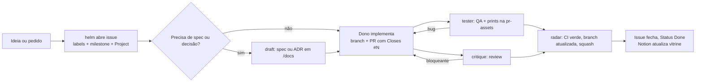

# Processo de desenvolvimento (modelo reutilizável)

Guia pra repetir a organização do MangaJP Study ([murilinhoPs/MangaJP](https://github.com/murilinhoPs/MangaJP)) em projetos novos, ou pra passar pra outra IA trabalhar do mesmo jeito. Estado lido do repo em 26/10/2026.

## 1. Princípio

- **GitHub é a fonte da verdade.** Tasks são issues, o andamento é o GitHub Project, e spec, decisões e regras ficam em [`/docs`](README.md) no próprio repo.
- **Notion é vitrine.** Resumo, links, design brief e galeria de prints. Sem tasks e sem spec viva. Se Notion e `/docs` divergirem, vale `/docs`.
- **O que muda junto com o código mora junto com o código.** PR que muda comportamento atualiza a spec no mesmo PR.

## 2. Estrutura de docs no repo

```text
README.md                 o que o app faz e como rodar (sem copiar comportamento)
docs/
  README.md               índice de /docs + regras + convenções
  prd.md                  visão, escopo, jornadas, stack; linka as specs
  roadmap.md              visão das milestones (sem tasks)
  processo.md             processo de desenvolvimento (este arquivo)
  specs/<feature>.md      uma spec por feature, comportamento ATUAL
  adr/README.md           índice + template de ADR
  adr/NNNN-titulo.md      uma decisão por arquivo
  qa/print-rules.md       como tirar e anexar print
  qa/telas.md             índice GERADO das telas (não editar à mão)
  assets/                 só prints oficiais e finais (criada quando entrar o primeiro print oficial)
  <medições>.md           ex. m0.3-cer-bakeoff.md (números não se reescrevem)
.github/
  pull_request_template.md
  ISSUE_TEMPLATE/feature.yml, bug.yml
  workflows/ci.yml
```

### Papel de cada doc

| Doc | Pra quê | Regra |
| --- | --- | --- |
| [`prd.md`](prd.md) | Visão e escopo | Versão = git tag `prd-vX.Y`, nunca sha escrito no texto |
| [`specs/*.md`](specs/captura.md) | Como a feature se comporta hoje (rotas, estados, ações, ACs) | Atualiza no mesmo PR que muda o comportamento. Ambiguidade vira `> Pendente:`, sem inventar |
| [`adr/*.md`](adr/README.md) | Por que uma decisão foi tomada | ADR aceito é imutável. Pra mudar: ADR novo + status `Superada` no antigo |
| [`qa/print-rules.md`](qa/print-rules.md) | Contrato de evidência visual | Review e CI cobram |
| [`qa/telas.md`](qa/telas.md) | Catálogo das telas a partir dos prints | Gerado por script (`dart run tool/gen_telas.dart`) |

### Template de ADR

```markdown
# ADR-NNNN — Título
- Status: Proposta | Aceita | Superada | Revertida
- Data: YYYY-MM-DD
- Questão: Q-XX (se houver)
## Contexto
## Decisão
## Consequências
```

### Convenções que valem copiar

- IDs estáveis de feature (`F1…`) e de critério de aceite (`AC-…`) vindos do PRD. Não renomear.
- Prints de QA **não** vão pra `main`: ficam numa branch `pr-assets`, em `docs/pr-assets/pr-<N>/<sha7 do head>/<plataforma>/`, com um `print_sizes.txt` (head completo + sha256 de cada arquivo). Print recortado de propósito leva o token `recorte` ou `recorte=<motivo>` nessa linha; sem ele, print fora do tamanho da regra é marcado **fora da regra**.
- Identificadores fixos documentados uma vez (ex. bundle ID `dev.murilinhops.mangajp` em todas as plataformas).

## 3. Estrutura no GitHub

### Issues = tasks

Toda task é uma issue, criada pelos templates:

- **Feature** (`[feat] `, label `type:feature`): Área, caminho da Spec, Contexto, Critérios de aceite em checklist (um AC por item, usando os IDs da spec).
- **Bug** (`[bug] `, label `type:bug`): Área, Plataforma, Head, Repro, Esperado, Obtido, Critérios de aceite.

Issue "fila" pra trabalho que depende de hardware ausente. No MangaJP, a [#54](https://github.com/murilinhoPs/MangaJP/issues/54) é a fila Mac/iOS: cada item tem PR de origem, o que rodar e o head. O PR referencia o item com `n/a: Mac offline — #54 item: <link>`.

### Labels (três eixos)

| Eixo | Labels |
| --- | --- |
| Tipo | `type:feature`, `type:bug`, `type:chore`, `type:docs`, `type:design` (exige prints) |
| Prioridade | `prio:high` (próximo da fila), `prio:med`, `prio:low` (backlog) |
| Área | `area:capture`, `area:ocr`, `area:dictionary`, `area:review`, `area:shell`, `area:platform` |

As áreas espelham as pastas de feature do código e as specs. Em projeto novo, troque pela lista de features dele.

### Project (GitHub Projects v2)

[Project MangaJP Study](https://github.com/users/murilinhoPs/projects/1), com campos:

| Campo | Valores | Uso |
| --- | --- | --- |
| Status | Todo, In Progress, Done | Estado da issue. Done quando o PR que fecha dá squash |
| Ordem | número | Ordem de execução dentro da prioridade |
| Dono | dash, draft, tester, critique, radar, helm, motif, Murilo | Quem é responsável agora (bot ou pessoa) |

Status, Ordem e Dono vêm da configuração do Project (não verificáveis pelo repo). Os campos nativos (Milestone, Labels, Linked PRs, Parent issue, Sub-issues) vêm de graça.

### Milestones

Um milestone por fase ou bloco de entrega, criado quando aparece a primeira task dele (não se cria milestone vazio). Hoje no MangaJP:

- `D — Docs e processo` (aberto)
- `M2 — Pós-M1: iOS, kanji e Cloud OCR` (aberto, com [#58](https://github.com/murilinhoPs/MangaJP/issues/58) e [#59](https://github.com/murilinhoPs/MangaJP/issues/59))

### Templates de PR e CI

O [PR template](../.github/pull_request_template.md) obriga:

- `Closes #N` e o head final (SHA de 40 caracteres).
- Checklist de prints (Android 390×844 e Linux 1280×800 obrigatórios em mudança de tela; macOS/iOS ou item na fila).
- Saída **real** do `integration_test` junto do `git rev-parse --short HEAD`, ou `n/a` com motivo.

O [CI](../.github/workflows/ci.yml) roda análise, testes, testes das tools, `dart run tool/gen_telas.dart --ref origin/pr-assets` (parseia os `print_sizes.txt` da `pr-assets` e gera o índice de telas) e checa os entitlements do macOS. Regra de processo que dá pra virar check vira check.

## 4. Como o desenvolvimento flui



Passo a passo:

1. **Entrada.** O pedido vira issue pelo template, com `type`, `prio`, `area`, milestone, Status Todo, Ordem e Dono no Project.
2. **Definição.** Se a feature não tem spec, ou envolve escolha nova, o draft escreve ou ajusta `docs/specs/<feature>.md` ou abre ADR antes do código.
3. **Execução.** O dono move pra In Progress, abre branch e PR com `Closes #N`. Um PR por corte pequeno e verificável (no polish de telas, um PR por tela).
4. **Prova.** Mudança de tela exige prints de emulador no head final, nunca print web nem só golden. Comportamento muda, spec muda no mesmo PR.
5. **Revisão.** O critique revisa; bloqueante volta pro implementador e é re-revisado depois do push. O tester exercita o app e reporta com repro.
6. **Merge.** O radar garante CI verde e branch atualizada e faz o squash. A issue fecha sozinha pelo `Closes`, e o Status vai pra Done.
7. **Vitrine.** O Notion recebe só o resumo e os links do que entrou.

### Review gate (critique)

- Revisa só o diff real do head e posta a review travada no sha desse head. Push novo pede re-review.
- Três severidades: bloqueante segura a aprovação e volta pro implementador (o que corrigir, por quê, arquivos) pedindo push no mesmo PR; deveria e nit só são reportados e viram follow-up se fizer sentido.
- CI verde no head.
- PR visual: abre cada print e confere o conteúdo contra os critérios de aceite, não só o tamanho; o `print_sizes.txt` traz o sha do head e o sha256 de cada print.
- Tela com layout de celular e de tela larga: lê os dois caminhos de código; faltar teste pra um deles é bloqueante.
- Validação que depende de máquina offline fica `n/a` com link pra issue adiada e não bloqueia.

### Merge gate (radar)

O squash só acontece quando tudo isto vale:

- O head atual está aprovado (critique ou dono do projeto). Push novo derruba a aprovação.
- O CI está verde nesse mesmo head.
- O PR não está em draft e a branch não está muito atrás da `main`. O radar atualiza a branch; conflito volta pro implementador.
- Se o tester está no PR, o QA dele passou e ninguém pediu pra segurar.
- PR visual tem prints no corpo, nos tamanhos definidos, sem hover; borrão ou recorte só pra dado sensível, declarado no PR.

Formato do squash: travado no sha do head, título `<título> (#N)`, corpo com `Closes #X` e trailer `Co-authored-by`. Depois o radar avisa o PM na sala e, em merge visual, manda os prints pro draft atualizar a doc de telas.

Exceções combinadas:

- Trabalho roda na nuvem por padrão. O que só roda em macOS/iOS vira item na fila (#54) e não bloqueia o PR; quando o Mac liga, a fila roda inteira.
- Print vai sem edição. Só pode borrar ou recortar dado sensível, avisando no PR. Recorte fora do tamanho padrão precisa do token `recorte` ou `recorte=<motivo>` no `print_sizes.txt`.
- Force-push na `pr-assets` só com aprovação do dono do projeto.

## 5. Papéis (time de bots)

| Papel | Bot | Faz | Não faz |
| --- | --- | --- | --- |
| PM | helm | Issues, labels, milestones, Project, Notion | Código, spec longa |
| Docs | draft | PRD, specs, ADRs, regras em `/docs` | Código |
| Implementação | dash (Flutter), repl (Clojure), dom (front-end) | Código, testes, PR | Docs de produto |
| Review | critique | Review com severidade; devolve bloqueante | Implementar fix |
| QA | tester | Testa o app, prints, UX com motivo | Corrigir |
| Monitor | radar | PRs, CI, atualizar branch, squash | PM, review |
| Design | motif | Telas, paleta, tipografia | Código |

Sem bots, os papéis continuam valendo: uma pessoa (ou uma IA) só troca de chapéu.

## 6. Checklist pra começar um projeto novo

1. Criar repo e copiar `.github/` (templates de issue e PR, CI) e o esqueleto de `docs/` (README, `prd.md`, `processo.md`, `specs/`, `adr/README.md`, `qa/print-rules.md`).
2. Criar as labels `type:*`, `prio:*` e `area:*`, com as áreas = features do projeto.
3. Criar o Project com Status, Ordem e Dono e linkar o repo.
4. Escrever o PRD, quebrar em specs por feature e registrar as primeiras decisões como ADR.
5. Abrir as primeiras issues já dentro do primeiro milestone.
6. Criar a branch `pr-assets` órfã pra prints de QA.
7. Criar a página de vitrine no Notion, só com resumo e links.
8. Passar pra IA: "GitHub é a fonte da verdade; siga `docs/README.md` e os templates; toda task é issue no Project; PR fecha issue e atualiza spec."

## 7. Planejamento em duas etapas

### Etapa 1 — Preparação do projeto (visão geral)

Depois da PRD, gere [`roadmap.md`](roadmap.md) com todas as milestones (M0, M1, M2…), sem quebrar em tasks. A PRD só aponta pro roadmap.

Para cada milestone, só:

- Objetivo em 1 frase (o que fica provado ou entregue no fim).
- Escopo: lista das features da PRD (ids F#) que entram.
- Critério de saída testável (ex.: "o fluxo X roda de ponta a ponta no Android").
- Dependências ou decisões abertas que travam o começo dela.
- Tamanho aproximado (P/M/G).

M0 é sempre um spike de risco com go/no-go antes da M1.

Não crie issues nem milestones no GitHub nesta etapa. Abra um PR só de docs e pare.

### Etapa 2 — Planejamento de uma milestone (só quando ela for a próxima)

Quando eu pedir "planejar a M<n>":

1. Releia [`roadmap.md`](roadmap.md), a PRD e o que mudou desde a última milestone.
2. Detalhe a milestone num doc curto (`docs/specs/m<n>.md`): escopo final, fora de escopo, questões em aberto, critérios de aceite por feature, critério de saída testável, riscos e ordem sugerida.
3. Quebre em issues pequenas (uma por feature ou tela), cada uma com título, área, link pro doc, critérios de aceite, prioridade, ordem e "como verificar" (teste automatizado, fluxo manual, plataformas e se precisa de print).
4. Me mostre o doc e a lista de issues e espere meu ok. Não crie nada antes.
5. Depois do ok, crie o milestone `M<n> — <nome>` e as issues com `gh`, com labels, ligadas ao milestone, e adicione no Project com `Etapa` = `todo` e `Ordem`.
6. Se o escopo mudou, atualize [`roadmap.md`](roadmap.md) num PR só de docs.

Nunca abra issues de milestones futuras.
